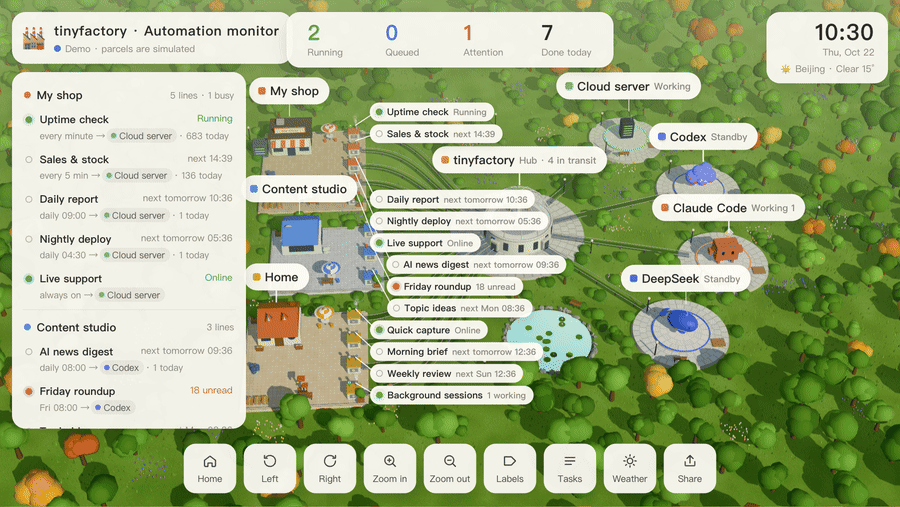
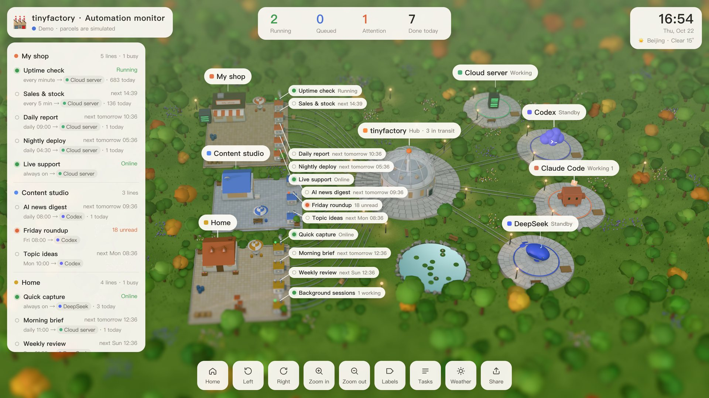
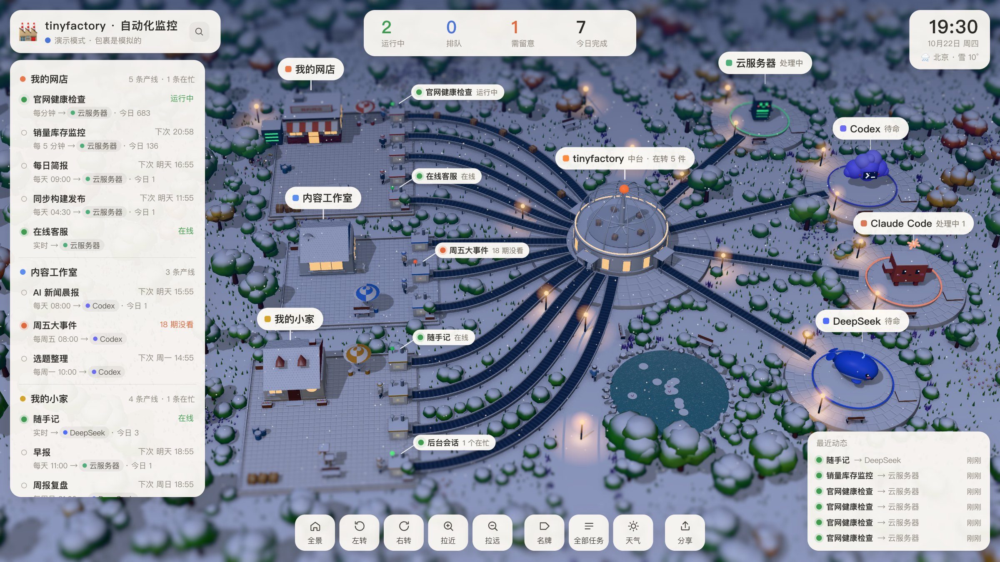

<div align="center">

# 🏭 tinyfactory

**把你的 AI 自动化变成一座会动的微缩工厂。**

一行命令，自动找出这台电脑上的 Claude Code、Codex、OpenClaw、cron、launchd、systemd 定时任务，
每条自动化是一条产线，每次运行是一个包裹，顺着传送带送到干活的 agent 面前。

**[在线演示](https://ybkjs.github.io/tinyfactory/)**（手机也能看） · [English](README.en.md) · 中文



</div>

## 为什么做这个

自动化越加越多以后，你很快就说不清自己到底有多少任务在跑，更说不清哪些早就悄悄停了。
作者动手做 tinyfactory 之前先盘点了一遍自己的电脑，结果发现 4 条定时任务已经停了几个月都没人发现（授权过期，连续失败 197 次）。tinyfactory 就是把这次盘点变成一直开着的样子。

列表能告诉你这些，但没人每天去看列表。一座会动的小工厂，你会愿意多看两眼。

灵感来自 [@Khazix0918 的自动化流水线可视化](https://x.com/Khazix0918/status/2112838884510048647)。tinyfactory 是一个独立实现的开源版本，重点放在「装上就能看到你自己的工厂」。

## 快速开始

```bash
npx github:ybkjs/tinyfactory            # 扫描这台电脑，打开你的工厂
npx github:ybkjs/tinyfactory --demo     # 先看看演示工厂
```

需要 Node.js 20+ 和 git。浏览器会自动打开 `http://127.0.0.1:4520/`。

## 它会自动发现什么

| 来源 | 读哪里 | 能看到 |
|---|---|---|
| Claude Code 后台会话 | `~/.claude/jobs/*/state.json` | 正在干活的、等你回复的、今天完成的 |
| Codex 自动化（ChatGPT 桌面版） | `~/.codex/automations/`、`~/.codex/sqlite/codex-dev.db` | 计划、下次运行、每次运行、没看的结果、停摆的任务 |
| OpenClaw 定时任务 | `~/.openclaw/cron/jobs.json` | 计划、连续失败次数、已停用 |
| crontab | `crontab -l` | 每一条定时命令 |
| macOS launchd | `~/Library/LaunchAgents/*.plist`（带定时的） | 计划、上次退出码 |
| Linux systemd | `systemctl` 定时器 | 计划、下次运行、今日次数、失败 |
| 任何别的东西 | `POST /api/event` | 你上报什么就显示什么 |
| 另一台机器上的 tinyfactory | 它的 `/api/state` | 服务器、NAS 上的任务汇总到同一张图（见下文） |

全部**只读**。找不到的来源会安静地跳过。

## 让任何脚本出现在工厂里

```bash
# 开始
curl -X POST localhost:4520/api/event -H 'content-type: application/json' \
  -d '{"line":"backup","name":"夜间备份","factory":"运维","status":"start"}'
# 成功 / 失败
curl -X POST localhost:4520/api/event -d '{"line":"backup","status":"done"}'
curl -X POST localhost:4520/api/event -d '{"line":"backup","status":"fail","msg":"磁盘满了"}'
```

字段：`line`（必填，产线 id）、`name`、`factory`（放进哪个厂区）、`agent`（`claude` / `codex` / `deepseek` / `openclaw` / `system` / `custom`）、`status`（`start` / `done` / `fail`）、`msg`。
每次 `done` 或 `fail` 都会变成一个包裹送到对应的 agent。

n8n、GitHub Actions、Python 脚本、飞书机器人……能发 HTTP 请求的都能接。

## 多台机器汇总到一张图

云服务器上的定时任务，笔记本是看不到的。办法是在服务器上也跑一份（只听本机），再用 SSH 隧道把它接过来：

```bash
# 服务器上
npx github:ybkjs/tinyfactory --host 127.0.0.1 --port 4520 --token 一串随机字符 --no-open
# 笔记本上：开一条隧道，把服务器的 4520 映射到本机 4525
ssh -N -L 4525:127.0.0.1:4520 you@your-server
```

然后在笔记本的配置里加上：

```json
{ "remote": [{ "name": "server", "url": "http://127.0.0.1:4525", "token": "一串随机字符" }] }
```

服务器的产线 id 会变成 `remote:server:原来的id`，`rename` / `assign` / `factories` 都能按这个规则重新命名、分组。服务器连不上超过一分钟，它的产线会标成「连不上」。
在服务器上跑的脚本也可以直接往服务器那份 tinyfactory 发 webhook，笔记本这边同样能看到包裹。

## 配置（可选）

`~/.tinyfactory/config.json`：

```json
{
  "title": "我的 AI 工厂",
  "city": "shanghai",
  "lang": "zh",
  "hide": ["launchd:*updater*"],
  "rename": { "systemd:site-health": "官网健康检查" },
  "assign": { "systemd:*-report": "deepseek" },
  "factories": [
    { "name": "我的网店", "match": ["systemd:shop-*", "cron:*"], "building": "shop", "color": "#e8774a" }
  ],
  "systemd": { "services": ["my-bot"] }
}
```

- `hide`：不想看的产线（支持 `*`）
- `rename`：给产线换个人话名字
- `assign`：指定哪个 agent 在干这条线的活
- `factories`：按你的项目重新分厂区（`building`: `shop` / `studio` / `home`）
- `systemd.services`：一直在线的服务也放进来，显示为「在线」
- `lines`：这台电脑看不到的任务（云服务器、SaaS 里的定时任务）先手动挂上地图，显示「未接入」，例如
  `{ "id": "backup", "name": "夜间备份", "factory": "我的网店", "agent": "system", "schedule": { "type": "cron", "value": "0 3 * * *" } }`

产线 id 在页面左侧列表里点开就能看到，规则是 `来源:名字`，比如 `codex:daily-news`、`systemd:backup`。

## 场景里有什么

- **真实的时间和天气**：太阳按你所在城市的经纬度走，晚上路灯和窗户会亮；下雨下雪会同步到场景里（天气来自 [Open-Meteo](https://open-meteo.com/)）。右上角可以切城市，也可以预览傍晚、夜晚、雪夜。
- **看得懂的状态**：绿灯运行中，红灯需留意（连续失败、停摆、结果没人看），空心是在等下次运行。
- **分享**：底部「分享」按钮把当前画面存成图片。
- **拖动旋转、右键平移、滚轮缩放**，点左侧任意一条产线，镜头会飞过去。

| 傍晚 | 雪夜 |
|---|---|
|  |  |

## 隐私

- 只监听 `127.0.0.1`，不上传任何数据，没有统计。
- 只读：不会修改你的任何任务。
- 唯一的外部请求是天气：把你选的城市坐标发给 Open-Meteo。
- 想在局域网或服务器上开放，必须加 `--token`：`npx github:ybkjs/tinyfactory --host 0.0.0.0 --token 你的密码`。

## 命令行参数

```
--demo            演示工厂（包裹是模拟的）
--port <n>        端口，默认 4520
--host <addr>     默认 127.0.0.1
--city <name>     beijing、shanghai、shenzhen、hangzhou、london、newyork…
--lang <zh|en>    界面语言
--config <file>   默认 ~/.tinyfactory/config.json
--interval <s>    多久扫一次，默认 10 秒
--token <secret>  对外开放时用
--no-open         不自动打开浏览器
```

页面参数：`?q=low|high`（画质）、`?fps=60`、`?tilt=1`（移轴虚化）、`?city=`、`?lang=`、`?weather=dusk|night|rain|snow|snow-night`。

## 性能

默认按屏幕原生分辨率渲染，封顶每秒 30 帧，窗口不在前台时降到每秒 12 帧；卡的时候会自动降一档。8GB 内存的 MacBook 上实测流畅。老电脑可以用 `?q=low`。

## 新增一个来源

一个来源就是 `src/sources/` 下的一个文件，导出 `collect(ctx)`，返回厂区、agent、产线和运行记录：

```js
export const id = "my-tool";
export async function collect(ctx) {
  return {
    factory: { id: "my-tool", name: "My tool", building: "studio", color: "#5b8def" },
    agent: { id: "custom", kind: "custom" },
    lines: [{ id: "my-tool:job", name: "Job", schedule: { type: "cron", value: "0 9 * * *" }, status: "scheduled", next: Date.now() + 3600e3 }],
    runs: [{ id: "my-tool:job:1", line: "my-tool:job", at: Date.now(), ok: true }]
  };
}
```

然后加到 `src/collect.mjs` 的 `SOURCES` 里。欢迎 PR：GitHub Actions、n8n、Cursor、Windows 任务计划……

## 开发

```bash
git clone https://github.com/ybkjs/tinyfactory && cd tinyfactory
npm install
npm run demo        # 演示模式
npm test            # 测试
npm run record      # 重新录 README 里的图（需要 Chrome 和 ffmpeg）
```

## 致谢

- 灵感：[@Khazix0918](https://x.com/Khazix0918/status/2112838884510048647)
- 渲染：[three.js](https://threejs.org/)
- 天气：[Open-Meteo](https://open-meteo.com/)

角色是通用造型，没有使用任何官方 logo 素材；Claude、Codex、DeepSeek、OpenClaw 等名称归各自的所有者。

## 许可

[MIT](LICENSE)
